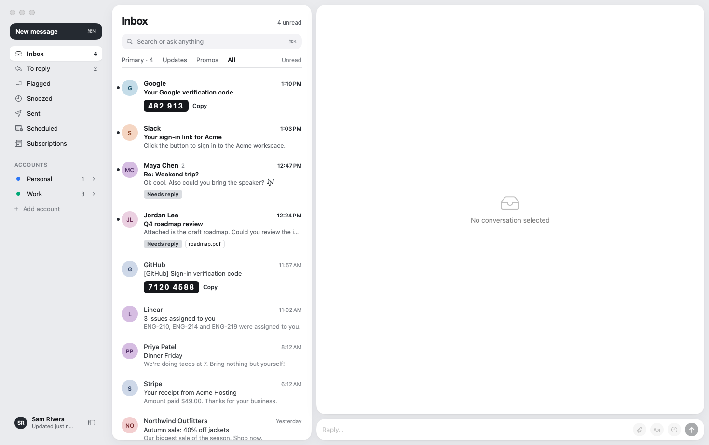
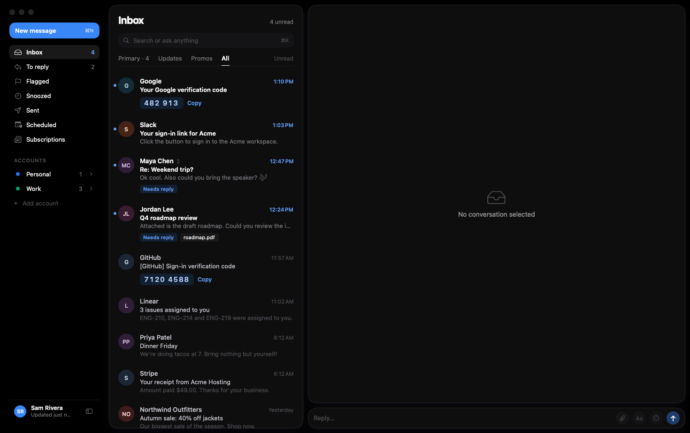

<h1 align="center">Inkwell</h1>

<p align="center">
  <b>A fast, private, native email app for the Mac.</b><br>
  Your Mac talks straight to your mail provider. No middleman servers, no tracking, no account to create.
</p>

<p align="center">
  
  
  
</p>



## Highlights

- ⚡️ **Fast.** Native Swift with a local search index. Emails open instantly, and new mail arrives the moment it lands (IMAP IDLE).
- 🔐 **Sign-in codes without the hunt.** Codes and magic links pop up below the notch: copy or open them in one click.
- 🛡️ **Private by default.** Tracking pixels removed, link trackers stripped, remote images blocked until you allow them.
- 📬 **All your accounts, one inbox.** Gmail, iCloud, Outlook, Yahoo, Fastmail or any IMAP server, side by side.
- ✨ **Optional AI.** Summaries, suggested replies and rewrites, on-device or with your own key.

### Sign-in codes and links, straight from the notch

When a verification code or sign-in link arrives, Inkwell shows it below the notch. Copy the code or open the link without opening the email. Codes also get a **Copy** chip right in the inbox.

<p align="center">
  
  
</p>

### Dark mode



## Features

### 📥 Inbox
- Unified inbox across accounts, with a colour per account and unread counts
- Smart tabs: **All**, **Primary**, **Updates**, **Promos**, plus an Unread filter
- **To Reply** shows people waiting on you; also Flagged, Snoozed, Awaiting Reply and Scheduled
- Gmail-style keyboard shortcuts, with optional Vim keys

### 💬 Reading
- Chat-style or Classic conversation view, chosen per account
- Calendar invites as cards: Accept, Maybe or Decline, and Add to Calendar
- Quick reply from the conversation with ⌘↩

### ✍️ Writing
- Rich-text composer with drag-and-drop attachments
- Drafts save automatically and sync to your server's Drafts folder
- Signatures per account, and aliases with their own signature and Reply-To
- **Undo Send** (5–30 s), **Send Later** and **Remind me if no reply**

### 🔎 Search
- ⌘K searches every account instantly from a local index, and the server for older mail
- Command palette for actions, folders and settings

### 🗂️ Organising
- Snooze, archive, trash and move, all undoable
- Rules that run on the server, mute and block
- One-click unsubscribe and a list of all your subscriptions

### 🛡️ Privacy and safety
- Tracking pixels removed and link trackers stripped
- Remote images blocked until you allow them, and never loaded in Spam
- Warnings for phishing, look-alike domains and links that go somewhere other than they say

### 🔔 Notifications and the notch
- Notifications with **Copy Code** and **Open Link** buttons, plus a Dock badge
- New mail, sign-in codes and links below the notch
- Send animation with an Undo countdown, snooze alarms, and drop files on the notch to start an email

### ✨ AI (optional)
- Summaries, suggested replies, rewrite and translate
- Apple on-device (macOS 26), Ollama and LM Studio keep everything on your Mac; Claude, OpenAI and OpenRouter use your own key
- **MCP server** (`Inkwell --mcp`) lets AI apps like Claude read and organise your mail: 27 tools, and sending, rules, unsubscribing and blocking always ask you first. Every action is logged and can be undone.

## Getting started

### Build

```bash
./scripts/bundle.sh          # → build/Inkwell.app (release build, signed)
open build/Inkwell.app
```

Requires macOS 14+, Apple silicon and Xcode 16+. Drag `build/Inkwell.app` to /Applications to keep it.

**Signing:** `bundle.sh` signs with the first "Apple Development" certificate in your keychain (free: Xcode → Settings → Accounts → Manage Certificates → + → Apple Development). With one, the Keychain remembers that it allowed Inkwell and rebuilds open without password prompts. Without one, the app is ad-hoc signed and macOS asks again after each rebuild.

### Add your accounts

Settings → Accounts → **+**. Presets for Gmail, iCloud, Outlook/Microsoft 365, Yahoo and Fastmail, or enter any IMAP server.

Sign in with an **app password**:
- **Gmail:** Google Account → 2-Step Verification → App passwords
- **iCloud:** account.apple.com → App-Specific Passwords

## Your data

- Mail, the search index and settings live in `~/Library/Application Support/Inkwell` on your Mac.
- Account passwords and AI keys are stored in the macOS Keychain and readable only by Inkwell.
- The app connects only to your own mail servers, plus the AI provider you choose, if you turn AI on. When AI is on, the email text being summarised or rewritten is sent to that provider; Apple on-device, Ollama and LM Studio keep it on your Mac.
- No analytics, no telemetry, no Inkwell server.

## Not included (yet)

- OAuth sign-in ("Sign in with Google/Microsoft"). App passwords are used instead.
- Desktop widgets (needs a WidgetKit extension target; the `widget.json` snapshot is already written for it)
- iPhone app and iCloud sync of preferences (both need a paid Apple Developer account)

## For developers

```bash
swift build -c release
.build/release/Inkwell --selftest                                          # IMAP / MIME / classifier checks
INKWELL_HOME=/tmp/ink-bench .build/release/Inkwell --bench                 # 20k-message synthetic mailbox, times hot paths
python3 scripts/fake_imap.py 11430 2000 1 0.05 &                           # port, messages, CONDSTORE on/off, latency (s)
INKWELL_HOME=/tmp/ink-sync INKWELL_INSECURE_LOCAL=1 .build/release/Inkwell --synctest 11430
```

`INKWELL_HOME` keeps test data out of your real mailbox. `INKWELL_INSECURE_LOCAL` only allows plaintext connections to 127.0.0.1.

## License

[MIT](LICENSE)
